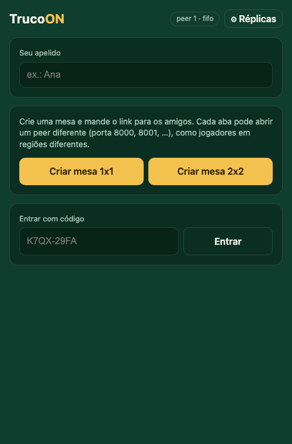
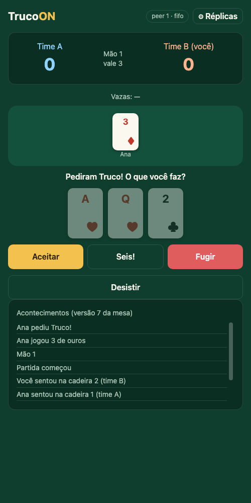
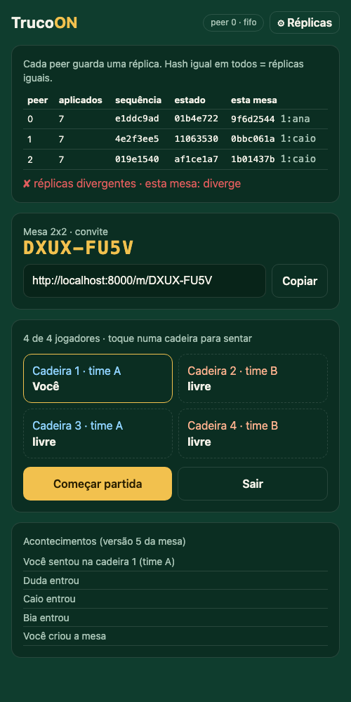
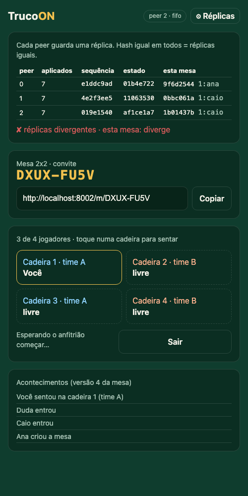
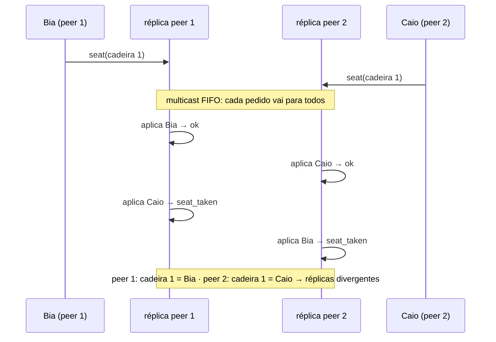
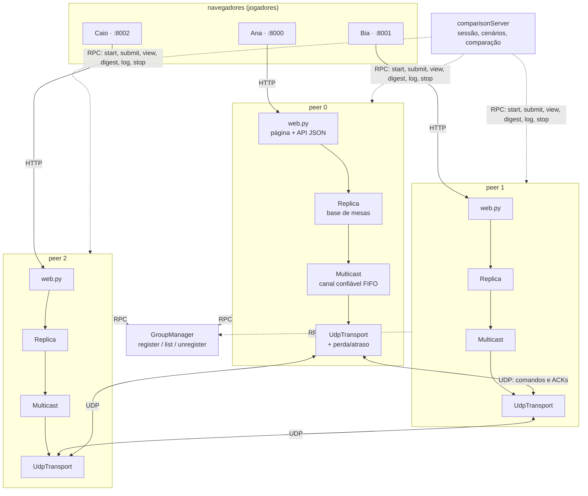
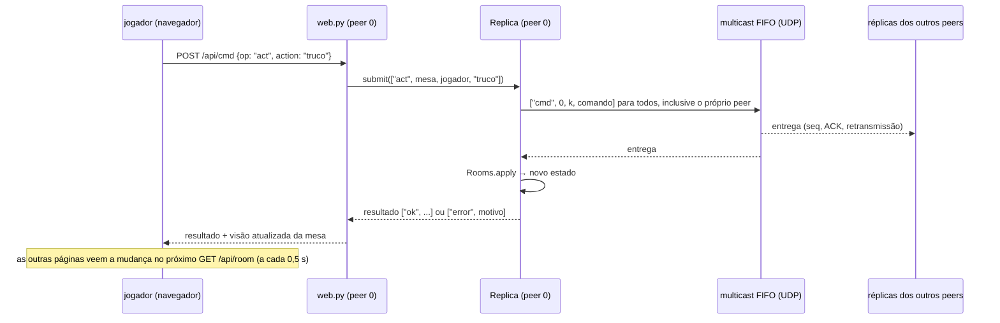
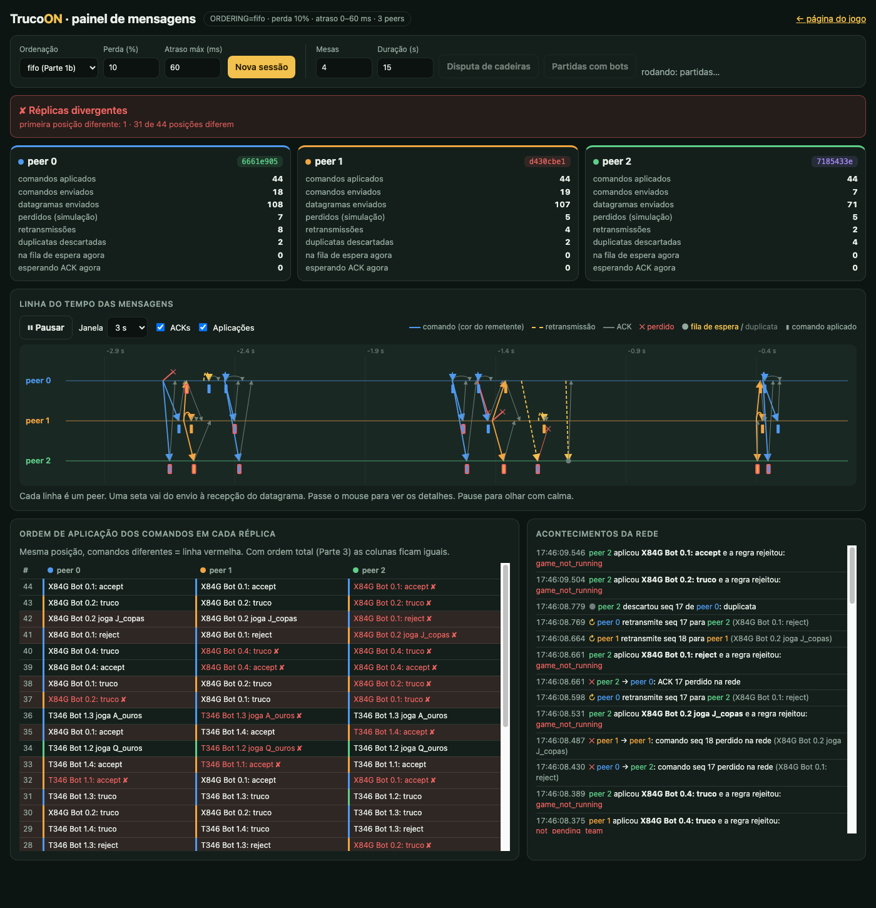

# TrucoON — Parte 2: truco online com mesas replicadas

Trabalho final de **Sistemas Distribuídos (INF0344)** — Ciência da Computação, UFG.
Base: [MPComm](https://github.com/professorfabio/MPComm), do Prof. Fábio M. Costa (cópia intacta em [`original/`](original/)).
Este repositório continua a [Parte 1](https://github.com/AndreFilho0/Trabalho-Final-Entrega-da-Parte-1)
(RPC + multicast UDP confiável com ordem FIFO) e dá um **significado** às mensagens e aos processos.

## Integrantes

| Nome | Matrícula | E-mail |
|---|---|---|
| André de Oliveira Machado Filho | 202406913 | andrefilho@discente.ufg.br |
| Ryan Gabryel Barbosa de Lima | 202301485 | ryanlima@discente.ufg.br |

## Testar localmente em 3 passos

Precisa só de Python 3.10+ (sem banco de dados, sem Node, sem Docker).

```bash
python3 -m venv .venv && source .venv/bin/activate && pip install -r requirements.txt

scripts/run_local.sh 4 disputa 8     # 4 peers, 8 mesas, disputa de cadeiras; compara as réplicas e encerra
scripts/run_local.sh 3 jogar         # 3 peers no ar para jogar pelo navegador (menu no terminal)
```

No modo `jogar`, abra **http://localhost:8000**, crie uma mesa e abra o link de convite em outra aba trocando a porta
(`:8001`, `:8002`): cada porta é um peer diferente, como amigos ligados a servidores em regiões diferentes. O botão
**⚙ Réplicas** mostra o hash da mesa em cada peer. O **painel de mensagens** fica em
**http://localhost:8000/painel**: linha do tempo dos datagramas entre os peers, ordem em que cada réplica aplicou os
comandos e botões para abrir sessões e rodar os cenários (ver [Painel de mensagens](#painel-de-mensagens)).

Por padrão o script simula **10% de perda e 0–60 ms de atraso** por datagrama (`LOSS=0 DELAY_MAX=0` desliga) e usa
o multicast **FIFO** da Parte 1 (`ORDERING=none` usa o UDP cru do original). Outros comandos:

```bash
DURACAO=20 scripts/run_local.sh 4 partidas 4   # 4 partidas 2x2 inteiras jogadas por bots em peers diferentes
pytest                                          # 36 testes: regras, base replicada, UDP real com perda
```

## A aplicação

**TrucoON** é um **truco mineiro online** para partidas privadas, 1x1 ou 2x2. Uma pessoa cria a mesa, manda o link
para os amigos, cada um escolhe uma cadeira e o anfitrião começa a partida.

Regras implementadas (`truco/`): baralho de 27 cartas com **manilhas fixas** (zap, copas, espadilha, pica-fumo),
vazas com empate ("cangar"), **truco → seis → nove → doze** com aceitar, aumentar ou fugir, **mão de 11** (o time
com 11 vê as cartas do parceiro e decide se joga), **mão de ferro** (11 a 11, às cegas) e partida até 12 tentos.

<p align="center">
  
  
</p>

### Significado dos processos

| Processo | No MPComm original | No TrucoON |
|---|---|---|
| **peer** (`peerCommunicator.py`) | envia mensagens numeradas sem sentido | servidor de uma "região": guarda uma **réplica completa da base de mesas** e atende os jogadores ligados a ele (página web) |
| **GroupManager** (`groupManager.py`) | registro dos peers | igual: registro, descoberta e saída dos peers |
| **comparisonServer** (`comparisonServer.py`) | dispara a rodada e compara a ordem das mensagens | abre a sessão do jogo, roda cenários com bots e **compara as réplicas** |

### Significado das mensagens

Cada mensagem do multicast é um **comando** que altera a base replicada de mesas (`truco/rooms.py`):

```
["create",  código, jogador, modo, semente]   criar mesa ("1v1" ou "2v2")
["join",    código, jogador]                  entrar no lobby
["seat",    código, jogador, cadeira]         sentar (cadeiras pares = time A, ímpares = time B)
["start",   código, jogador]                  começar a partida (só o anfitrião)
["act",     código, jogador, ação]            jogar carta, truco, aceitar, fugir, mão de 11...
["leave",   código, jogador]                  sair do lobby ou desistir da partida
["rematch", código, jogador]                  revanche
```

No datagrama UDP o comando vai como `["cmd", origem, k, comando]`: `(origem, k)` identifica o comando (k = 0, 1, 2…
por peer), no mesmo formato das mensagens `(processo, número)` do MPComm. Por isso `metrics.py` da Parte 1 continua
medindo perdas, duplicatas, violações FIFO e posições divergentes, agora sobre os comandos aplicados por cada réplica.

As **consultas** (ver a mesa, as cartas da própria mão) não passam pelo multicast: são lidas da réplica local.

## Por que a ordem das mensagens é crítica

Cada réplica aplica os comandos com `Rooms.apply`, uma função **determinística**: mesmo estado + mesmo comando ⇒
mesmo resultado, inclusive os erros. Então o estado de uma réplica depende **só da sequência** de comandos que ela
aplicou (**replicação por máquina de estados**). Se duas réplicas aplicam os mesmos comandos em ordens diferentes,
elas **divergem**. No truco isso aparece o tempo todo:

1. **Disputa de cadeira.** Bia (peer 1) e Caio (peer 2) tocam na cadeira 1 ao mesmo tempo. A réplica que aplica Bia
   primeiro dá a cadeira a ela e rejeita Caio (`seat_taken`); a outra faz o contrário. Cada um vê a si mesmo sentado.
2. **Truco × carta.** Ana joga a carta enquanto Bia pede truco. Numa réplica a carta entra primeiro e o truco
   depois; na outra o truco entra primeiro e a carta é rejeitada (`truco_pending`). A mesa de uma réplica tem a carta
   de Ana e a da outra não, e daí em diante vazas e placar seguem caminhos diferentes.
3. **Resposta ao truco no 2x2.** Os dois parceiros respondem juntos, um "aceito" e outro "fujo": cada réplica aplica
   primeiro uma resposta diferente, e numa a mão vale 3 enquanto na outra o adversário já marcou 1 tento.
4. **Efeito antes da causa.** Ana cria a mesa (peer 0) e Bia entra por ela (peer 1). O `join` de Bia só existe porque
   o `create` chegou ao peer 1, mas o peer 2 pode receber o `join` **antes** do `create` e rejeitá-lo
   (`room_not_found`): no peer 2 a Bia nunca entrou na mesa. FIFO ordena só mensagens de um mesmo remetente; não
   garante nem a ordem causal entre remetentes diferentes.

Os casos 1, 2 e a comutatividade são verificados em `tests/test_rooms.py`. A captura abaixo é o caso 1 (e o 4)
acontecendo de verdade, com 3 peers em FIFO, 10% de perda e até 60 ms de atraso: o mesmo instante visto pela página
do peer 0 (Ana sentou na cadeira 1) e pela do peer 2 (Caio sentou na cadeira 1; e a mesa tem 3 jogadores, porque o
`join` de Bia chegou antes do `create`).

<p align="center">
  
  
</p>



**O que FIFO não resolve, e a Parte 3 vai resolver**: para as réplicas ficarem iguais, todas precisam aplicar os
comandos na **mesma ordem total**, não só na ordem de cada remetente.

## Arquitetura



| Arquivo | Papel |
|---|---|
| `truco/deck.py`, `evaluator.py`, `rules.py` | baralho, força das cartas, quem ganha a vaza e a mão, apostas (funções puras) |
| `truco/game.py` | a partida como máquina de estados determinística; `view` esconde a mão dos outros |
| `truco/rooms.py` | **a base replicada**: mesas, lobby, cadeiras, partida; `apply(comando)` |
| `replica.py` | réplica da base em um peer: envia comandos pelo multicast e aplica o que é entregue |
| `peerCommunicator.py` | o peer: sessão, réplica, multicast, serviço RPC e servidor web |
| `web.py`, `static/index.html` | API HTTP sem estado e página do jogo (HTML + JS puro, mobile-first) |
| `msgtrace.py`, `static/painel.html` | registro do que passa por cada peer e o painel de mensagens |
| `bot.py` | jogador automático dos cenários |
| `comparisonServer.py` | abre a sessão, roda os cenários e compara as réplicas |
| `multicast.py`, `reliable.py`, `udpTransport.py`, `rpc.py`, `metrics.py` | infraestrutura da Parte 1 |

### O caminho de uma jogada



O ponto central: o peer **não aplica** o comando do próprio jogador na hora. Ele envia o comando ao grupo e **espera
a entrega pelo multicast**, como qualquer outra réplica, e só então responde ao jogador. Assim toda alteração passa
pelo protocolo de ordenação, e trocar FIFO por ordem total (Parte 3) não muda nada na aplicação.

### Determinismo

Para "mesma sequência ⇒ mesmo estado" valer, nada fora do comando pode influenciar o resultado:

- **Embaralhamento**: `random.Random(semente)`, com a semente sorteada pelo peer que cria a mesa e enviada **dentro
  do comando** `create`. Todas as réplicas dão as mesmas cartas. A semente de cada mão é `semente × 1000 + número da mão`.
- **Sem relógio nem timers** na lógica do jogo: tudo que muda o estado é um comando.
- **Código da mesa**: sorteado pelo peer de origem e enviado no comando. Se colidir, todas as réplicas rejeitam igual
  (`code_taken`) e o peer tenta outro.
- **Erros determinísticos**: o comando é aplicado sobre uma cópia da mesa; se a regra rejeita, a base fica intacta
  em todas as réplicas, pelo mesmo motivo.

### Como as réplicas são comparadas

Cada réplica expõe por RPC (`digest`) e no painel **⚙ Réplicas**:

- **aplicados**: quantos comandos já aplicou;
- **hash da sequência**: hash encadeado `h = sha256(h | origem:k)` dos comandos na ordem aplicada; muda se a ordem mudar;
- **hash do estado**: sha256 do JSON canônico de toda a base; igual em todas as réplicas ⇔ réplicas idênticas;
- **hash de cada mesa**, com o resumo de quem está em cada cadeira e o placar.

A sequência pode diferir com o estado igual quando os comandos trocados de ordem **comutam** (por exemplo, jogadas
em mesas diferentes). O que importa para a consistência é o hash do estado.

## Painel de mensagens

`http://<qualquer peer>:8000/painel` mostra ao vivo o que acontece entre todos os peers do grupo. O peer que serve a
página junta, por RPC, os eventos registrados por cada peer (`msgtrace.py`): cada datagrama enviado e recebido e
cada comando aplicado na réplica.



- **Controles**: abrir uma **sessão nova** em todos os peers (réplicas vazias) escolhendo a ordenação (`fifo` ou
  `none`), a perda e o atraso simulados, e rodar os cenários **disputa de cadeiras** e **partidas com bots** sem
  usar o terminal.
- **Faixa de consistência**: verde quando as réplicas estão idênticas, amarela quando o estado é igual mas a ordem
  difere em comandos que comutam, vermelha quando divergem (com a primeira posição diferente).
- **Cartão de cada peer**: comandos aplicados e enviados, datagramas, perdas simuladas, retransmissões, duplicatas
  descartadas, mensagens na fila de espera e sem ACK naquele instante, e o hash do estado (mesma cor = mesmo estado).
- **Linha do tempo**: uma raia por peer; cada seta vai do envio à recepção de um datagrama. Comandos têm a cor do
  remetente, retransmissões são tracejadas em amarelo, ACKs são finos e cinza, ✕ é um datagrama perdido pela
  falha simulada, ● amarelo é uma mensagem que chegou adiantada e ficou na fila de espera, ● cinza é duplicata, e
  ▮ marca o momento em que a réplica aplicou um comando (na cor de quem o enviou). Passar o mouse mostra seq,
  comando, horários e latência; **Pausar** congela a tela para explicar.
- **Ordem de aplicação**: os últimos comandos aplicados por cada réplica, alinhados pela posição na sequência.
  Linha vermelha = naquela posição as réplicas aplicaram comandos diferentes. Com FIFO isso aparece logo; com a ordem
  total da Parte 3 as colunas devem ficar idênticas.
- **Acontecimentos da rede**: perdas, retransmissões, mensagens que foram para a fila de espera e saíram dela,
  duplicatas e comandos que a regra rejeitou numa réplica.

Para ligar envio e recepção, cada datagrama leva um número `x` do remetente (o par remetente + `x` identifica o
datagrama). Os horários vêm do relógio de cada peer: numa máquina só é o mesmo relógio; em máquinas diferentes a
diferença entre os relógios entorta as setas, mas não muda as contagens nem a comparação das réplicas.

## Resultados

`scripts/run_local.sh 4 <cenário>`: 4 peers numa máquina. **Disputa**: 8 mesas 2x2, os 4 jogadores de cada mesa em
peers diferentes pedem as cadeiras ao mesmo tempo. **Partidas**: 4 mesas 2x2 com bots jogando por 20 s.

| Cenário | Rede | `ORDERING` | Comandos | Faltando por réplica | Violações FIFO | Posições divergentes | **Mesas divergentes** |
|---|---|---|---|---|---|---|---|
| disputa | 10% perda, 0–60 ms | `none` | 133 | 7 a 17 | 34 a 50 | 126 de 126 | **11 de 11** ¹ |
| disputa | 10% perda, 0–60 ms | `fifo` | 125 | 0 | 0 | 123 de 125 | **8 de 8** |
| disputa | sem perda, sem atraso | `fifo` | 112 | 0 | 0 | 8 de 112 | **1 de 8** |
| partidas | 10% perda, 0–60 ms | `none` | 60 | 4 a 10 | 0 | 55 de 56 | **4 de 4** ² |
| partidas | 10% perda, 0–60 ms | `fifo` | 262 | 0 | 0 | 203 de 262 | **4 de 4** |
| partidas | sem perda, sem atraso | `fifo` | 233 | 0 | 0 | 4 de 233 | **1 de 4** |

¹ Em `none` o `create` também se perde; o cenário tenta de novo com outro código, por isso há mais de 8 mesas.
² Em `none` as cadeiras e o `start` se perdem em algumas réplicas e as partidas mal começam.

O que os números mostram:

- **Sem a Parte 1b** (`none`), a base nem recebe todos os comandos: cada réplica perde de 5% a 17% deles. Não há
  jogo possível.
- **Com FIFO**, nenhuma réplica perde comando e a ordem de cada remetente é respeitada, mas **todas as mesas
  divergem** quando há atraso de rede, e **mesmo em localhost, sem perda nem atraso**, uma em cada 4 a 8 mesas
  diverge. Basta dois jogadores agirem quase ao mesmo tempo por peers diferentes.
- Quando uma partida diverge, ela costuma **travar**: numa réplica é a vez de Ana, na outra é a vez de Bia, e cada
  bot espera a própria vez segundo a réplica do seu peer.

## Outras melhorias no código-base

Além das da Parte 1 (RPC, canal confiável FIFO, métricas corretas, fim da espera ativa, portas por peer, sem
`api.ipify.org`):

| MPComm original | Agora |
|---|---|
| `unregister` era um `# to do` | `exposed_unregister`; o peer sai da lista ao encerrar |
| Peer que reinicia aparece duas vezes na lista | registro idempotente por (IP, porta UDP) |
| Mensagens sem significado; toda a lógica num arquivo | camadas separadas: transporte UDP → canal confiável → réplica → regras puras do jogo → web |
| Lógica de aplicação misturada com rede (impossível testar sem subir processos) | regras e base de mesas são funções puras, testadas sem rede |
| Resultado só no terminal do servidor | painel de réplicas ao vivo na página e comparação por hash |
| Sem testes | 36 testes, incluindo réplicas reais trocando comandos por UDP com 20% de perda |

## Rodar em máquinas diferentes (nuvem)

```bash
# instância dos servidores (IP 1.2.3.4)
python groupManager.py
ORDERING=fifo LOSS=0 python comparisonServer.py --wait-peers 3      # menu interativo

# cada instância de peer
HOST=<ip-publico-deste-peer> GROUPMNGR_ADDR=1.2.3.4 python peerCommunicator.py
```

Portas a liberar: 5680 (TCP) no GroupManager; 5700 (TCP, RPC), 6789 (UDP) e 8000 (TCP, página) nos peers. Os
jogadores abrem `http://<ip-do-peer>:8000`.

## Roteiro do vídeo

1. O que a Parte 2 pede e a ideia: cada peer é um servidor de uma região com uma réplica das mesas de truco.
2. Jogar: criar mesa em `:8000`, abrir o convite em `:8001` e `:8002`, sentar, começar, pedir truco, com o
   `/painel` aberto em outra janela mostrando as setas de cada jogada.
3. Explicar o caminho de uma jogada: o peer não aplica na hora, manda pelo multicast e espera a entrega.
4. No painel, **Pausar** e mostrar uma perda (✕), a retransmissão e a mensagem que esperou na fila.
5. Disputa de cadeiras pelo painel: faixa vermelha, linhas vermelhas na ordem de aplicação, cada jogador sentado
   na sua réplica (**⚙ Réplicas** na página do jogo).
6. Nova sessão com `none`: perdas sem retransmissão; volta para `fifo`: nada se perde, mas a divergência continua.
7. Gancho para a Parte 3: falta uma ordem total.
